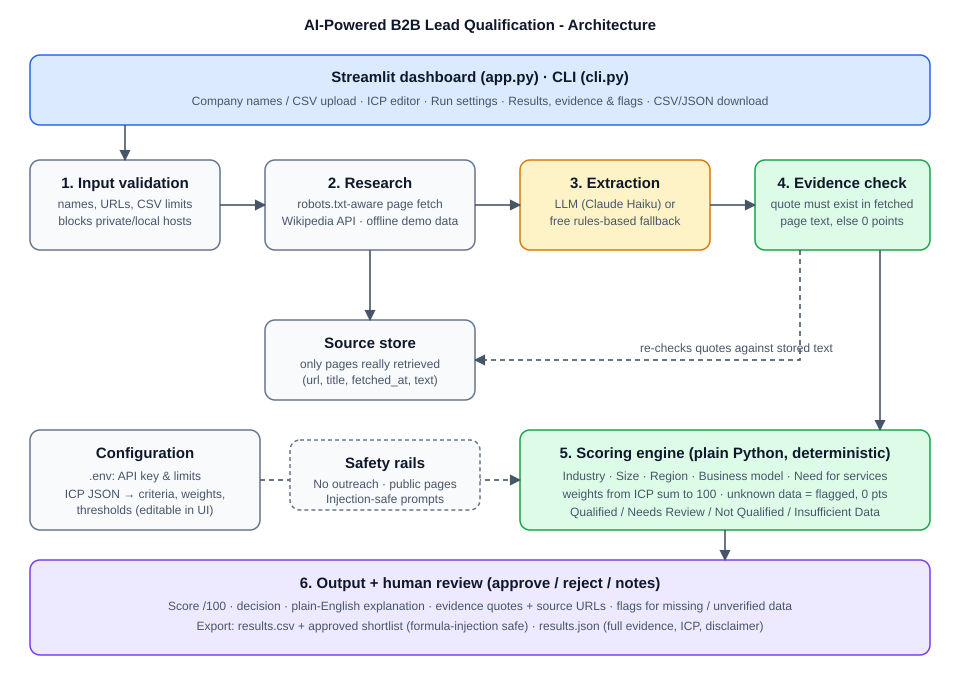

# 🎯 AI-Powered B2B Lead Generation & Qualification System

Agentic AI Solution Engineer (FDE) internship assessment project.

**Use case:** help a B2B technology consulting firm (cloud solutions, data analytics, AI automation) find, research, score
and prioritise potential customers for **human review**. See [docs/USE_CASE_AND_ICP.md](docs/USE_CASE_AND_ICP.md).

Give it company names or a CSV. It researches **public** information, compares each company with a
configurable **Ideal Customer Profile (ICP)**, gives a **transparent score out of 100**, explains the
decision, shows the **evidence and source URL** behind every point, flags what is **missing or unverified**,
and exports **CSV / JSON**.

> It never contacts prospects (no email, forms, LinkedIn, or calls) and never invents sources.
> **A score supports human review; it is not proof that a company is ready to buy.**

```mermaid
flowchart LR
  A[Names / CSV] --> B[Validation]
  B --> C[Research: website + Wikipedia API / demo data]
  C --> D[Extraction: Claude Haiku or free rules]
  D --> E[Evidence check: quote must exist in fetched page]
  E --> F[Scoring engine: ICP weights = 100 pts]
  F --> G[Explanation + flags]
  G --> H[Human review: approve / reject / notes]
  H --> I[Dashboard + CSV / JSON + approved shortlist]
```





## Quick start (Windows)

Requires **Python 3.10+** (from python.org, tick *Add python.exe to PATH*).

```bat
cd b2b-lead-qualifier
setup.bat
run_app.bat
```

Or by hand in Command Prompt / PowerShell:

```bat
py -3 -m venv .venv
.venv\Scripts\activate
pip install -r requirements.txt
copy .env.example .env
streamlit run app.py
```

The dashboard opens at <http://localhost:8501>. **It works immediately in Demo mode** (offline, no API key).

### Configure the API key (optional but recommended for Live mode)
1. Get a key at <https://console.anthropic.com> (pay-as-you-go; Haiku costs a fraction of a cent per company).
2. Open `.env` in Notepad and set: `ANTHROPIC_API_KEY=sk-ant-...your-key...`
3. Restart the app. The sidebar shows "API key loaded". The key is only read from `.env`; it is never
   displayed, logged, or exported, and `.env` is git-ignored.
4. If you see *"Model not found"*, set `LLM_MODEL` in `.env` to a current Haiku model name.

No key? Choose **Rules only** - free keyword/regex extraction still works, with the same evidence checks.

## How to use
1. **Companies tab** - type names (`HubSpot | hubspot.com`), upload a CSV (`company_name`, optional `website`),
   or load a sample. Invalid rows are reported, not silently dropped.
2. Pick **Demo** (fictional bundled data, offline) or **Live** (public web + Wikipedia).
3. **ICP tab** - edit industries, exclusions, employee range, regions, service-need keywords, weights (must total 100),
   thresholds. Save/load as JSON.
4. Press **Run research & scoring**, then open **Results**: filter, expand a company for the score breakdown,
   evidence quotes with links, flags, sources and the research log. Download CSV / JSON.

CLI alternative (no browser): `python cli.py --input data\sample_companies_demo.csv --mode demo`

## How scoring works (all in `leadgen/scoring.py`, no LLM involved)
| Criterion | Default pts | Full | Partial | Zero |
|---|---|---|---|---|
| Industry fit | 25 | matches a target industry | - | other (excluded industry = disqualified) |
| Company size | 15 | inside min-max employees (100-5,000) | within 50% below / 2x above range → half | further away |
| Region | 15 | HQ in target country/region | - | elsewhere |
| Business model | 10 | equals target (B2B) | serves both → 70% | opposite |
| Need for services | 35 | 3+ verified cloud / data / AI / modernisation / growth signals | 1 → 50%, 2 → 80% | none found |

**Evidence quality** (High ≥80% / Medium ≥50% / Low <50%) = share of the 100 points backed by verified quotes. It is shown
for every lead and it gates the decision: a high score on thin evidence becomes *Needs Review*, never *Qualified*.

Decisions: **Qualified** (≥70 and ≥50% of points backed by verified data) · **Needs Review** (≥45) ·
**Not Qualified** (<45 or excluded industry) · **Insufficient Data** (low score *and* little verified data).
Everything above is editable in the ICP tab.

## Human review step
Every result starts as **Pending review**. In the Results tab (*Human review* table) a person sets **Approved / Rejected /
Needs more research** and adds notes. These columns appear in the CSV/JSON, and an **approved shortlist** can be downloaded.
The project ends with that shortlist - nothing is sent to anyone.

## Tools & approach (why this design)
A deterministic **pipeline with one LLM step**, not a free-roaming agent: input validation → research (public pages, Wikipedia API)
→ extraction (Claude Haiku, or free rules) → evidence verification → plain-Python scoring → human review. Facts that decide a
sales lead must be auditable, so the LLM only *extracts quoted facts*; code verifies the quotes and does the scoring.
No LangChain/CrewAI was used because a fixed sequence of steps needs no agent framework (the brief says not to force technologies).
No RAG/vector store: each company's few fetched pages fit in one prompt.

## Documents for the assessment deliverables
| Deliverable | Where |
|---|---|
| Use case, ICP, criteria, score meaning | [docs/USE_CASE_AND_ICP.md](docs/USE_CASE_AND_ICP.md) |
| Architecture / workflow diagram | `docs/architecture.svg` (above) |
| Sample input / output | `data/sample_companies_demo.csv` → `output/sample_qualified_leads_DEMO.csv/.json` (fictional, labelled DEMO) |
| Test cases + observations (incl. incomplete record) | [docs/TEST_CASES.md](docs/TEST_CASES.md) |
| Demo script (checklist) | [docs/DEMO_SCRIPT.md](docs/DEMO_SCRIPT.md) |

## How fabrication is prevented
- Extractors must return a **verbatim quote + source URL** for each fact. Plain Python re-checks the quote against the
  stored page text; failures are marked unverified, flagged, and earn **0 points**.
- Employee counts must also appear as a number inside the quote.
- Sources listed are **only pages actually retrieved**. Failed fetches appear in the research log, not as data.
- Unknown ≠ guessed: missing facts are flagged and (by default) score 0.
- Page text is treated as untrusted. Prompt-injection text on a page is ignored (see the fictional *Cobalt Secure* demo page).
- Website discovery uses Wikipedia's official API (no search-engine scraping); if nothing is found you are told to provide the website.

## Safety & security
`.env` secrets · input validation (names, URLs, CSV size) · private/local IPs and non-http(s) URLs blocked (SSRF guard,
also on redirects) · robots.txt honoured · ~1 s delay between page requests · identifying User-Agent · CSV export
neutralises spreadsheet-formula injection · API errors (bad key, rate limit, timeouts, bad JSON) are caught with clear messages
and automatic fallback to the rules extractor, so one failure never stops a batch.

## Tests
```bat
run_tests.bat            (or: python -m pytest -v)
```
120 automated tests cover scoring boundaries, ICP validation, input validation, evidence verification (including rejected
fabricated quotes), LLM error handling (mocked), robots/SSRF handling, the full demo pipeline, exports, and a headless UI run.

## Project layout
```
app.py                  Streamlit dashboard          cli.py   command-line runner
leadgen/                config · icp · validation · research · extraction · evidence · llm · scoring · pipeline · exporter · regions
docs/                   USE_CASE_AND_ICP.md · TEST_CASES.md · DEMO_SCRIPT.md · architecture.svg
output/                 sample_qualified_leads_DEMO.csv / .json
data/                   icp_default.json · sample_companies_demo.csv · sample_companies_live.csv · demo_pages.json
tests/                  pytest suite                 docs/architecture.svg
setup.bat · run_app.bat · run_tests.bat · .env.example · requirements.txt
```
Only 4 runtime dependencies: `streamlit`, `pandas`, `requests`, `python-dotenv` (+ `pytest` for tests). No LLM SDK, no scraping framework.

## Known limitations (honest notes)
- **Demo mode uses fictional companies.** Live mode needs internet; I could not run it against real websites in my build
  environment, so live fetching is covered by mocked tests only - try `data/sample_companies_live.csv` on your machine.
- Many sites are JavaScript-rendered or block bots; those get flagged "no readable pages" instead of guessed.
- Employee counts and buying signals are often not on public pages → lower coverage, "Needs Review" or "Insufficient Data".
- Rules extractor is intentionally simple; the LLM extractor handles more phrasing but is still limited to the fetched text.
- Wikipedia only knows well-known companies; for others supply the website in the CSV.
- Scores are decision support for a human, not a substitute for judgement. Review before any outreach (done by you, manually).
